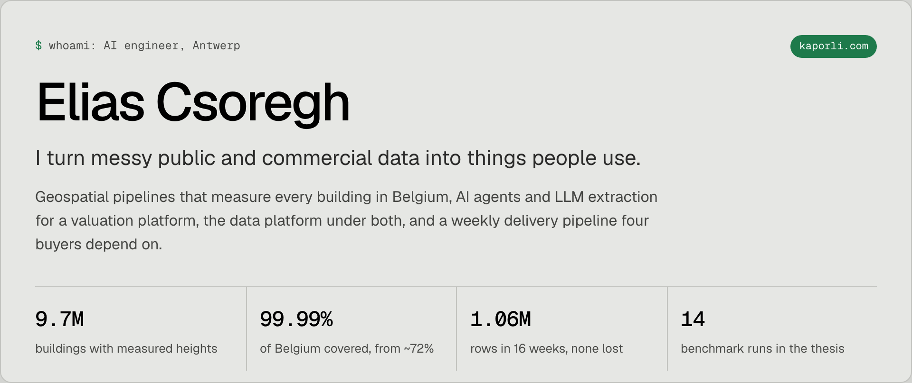

<a href="https://www.kaporli.com">
  <picture>
    <source media="(prefers-color-scheme: dark)" srcset="banner-dark.png">
    
  </picture>
</a>

### Work

- [Measured building heights for the whole country](https://www.kaporli.com/work#lidar): heights from laser scans for 9.7M buildings, then roofs reconstructed from the point clouds.
- [Structured fields from millions of listing descriptions](https://www.kaporli.com/work#extraction): an open-weight model under a strict JSON schema, in Dutch, French and English.
- [A support agent valuers talk to](https://www.kaporli.com/work#agent): one bot in Slack and Teams that answers in the valuer's language and drafts tickets for the right team.
- [Three hours a day, down to one approval](https://www.kaporli.com/work#fieldconcept): a weekly price-tracking operation rebuilt as a scheduled pipeline.

### Hobby projects

- [KaporlisTweaks](https://github.com/kaporli/KaporlisTweaks): a Steam Deck theme for Decky Loader's CSS Loader. [On DeckThemes](https://deckthemes.com/themes/view?themeId=d35475a7-16ad-40d6-b639-4d9d5f8d2c8a).
- [Solar](https://github.com/kaporli/Solar): a random forest that predicts a home solar installation's hourly yield from Belgian weather-station data.
- [Homelab](https://www.kaporli.com/homelab): one Proxmox host, nine guests, its own DNS, VPN and single sign-on.

### Education

BSc in AI and data engineering at HOGENT, cum laude, with a year in Vienna. [Thesis](https://www.kaporli.com/education): self-hosted LLMs for secure coding in enterprise environments.

[kaporli.com](https://www.kaporli.com) · [contact](https://www.kaporli.com/contact)
