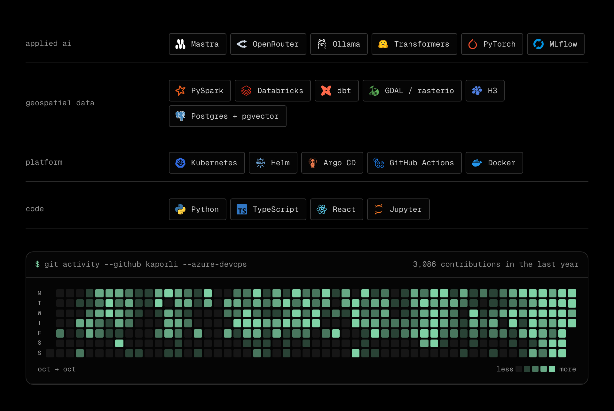
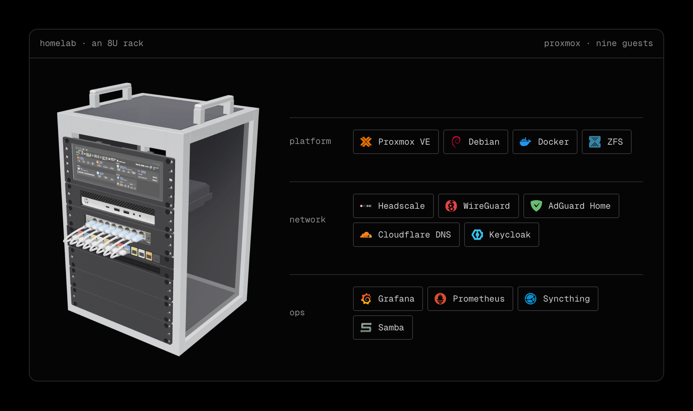

## Elias Csoregh

AI engineer in Antwerp. Applied AI and geospatial data engineering at work. Steam Deck plugins, a homelab and small machine-learning models at home.

[kaporli.com](https://www.kaporli.com) · [contact](https://www.kaporli.com/contact)

### Homelab

One Proxmox host in an 8U rack with nine guests, its own DNS, VPN and single sign-on. [The full tour](https://www.kaporli.com/homelab).

